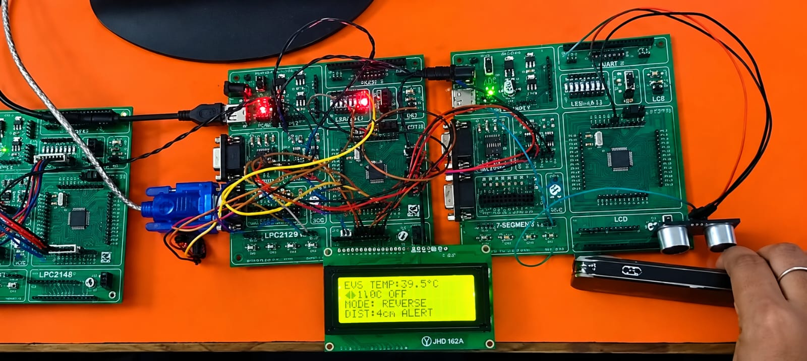
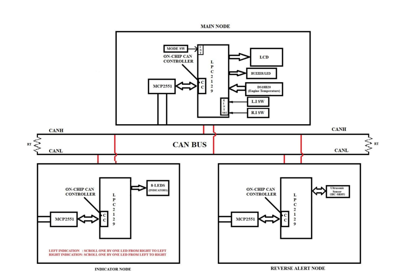
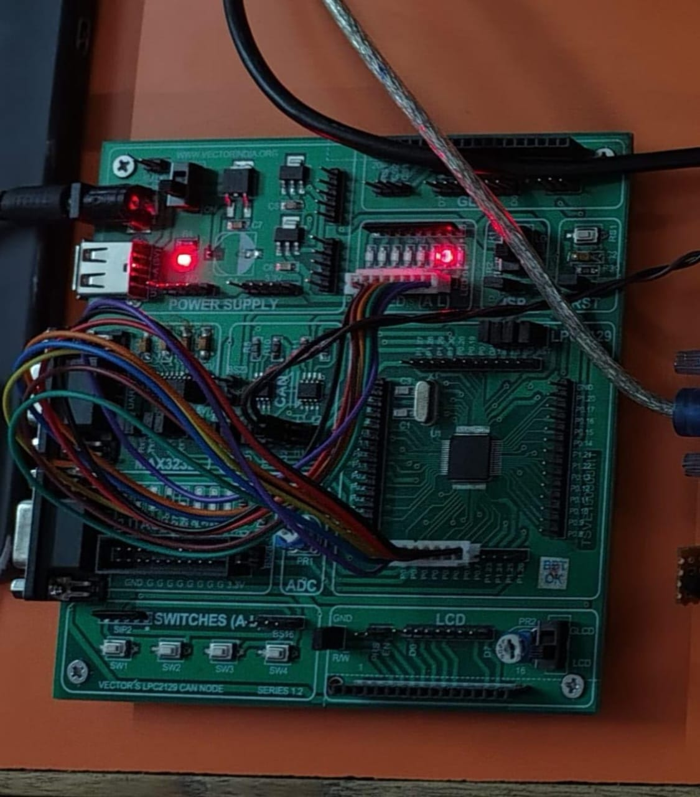
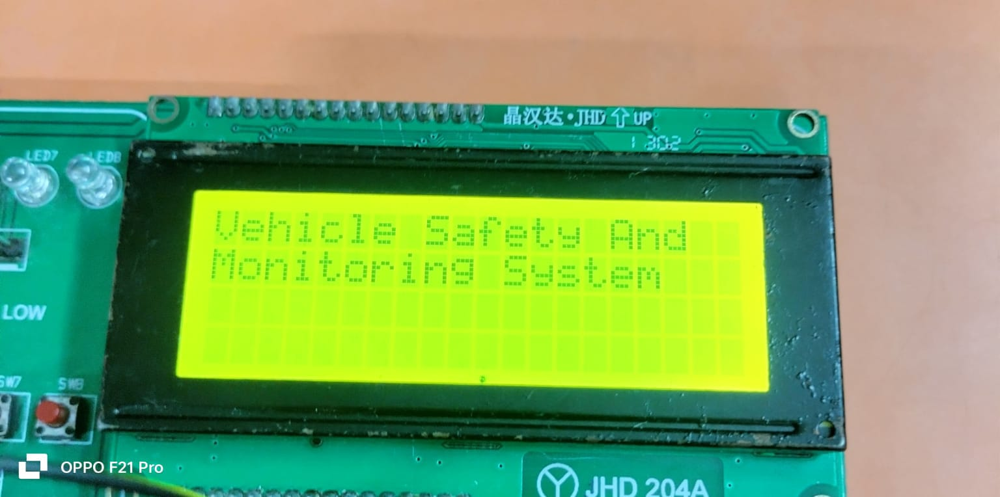
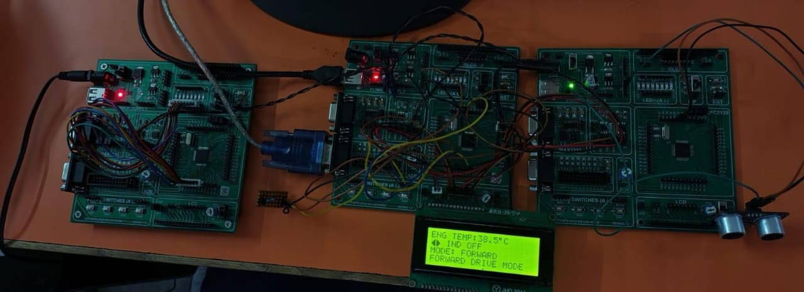

# Multi-Node CAN-Based Vehicle Monitoring and Reverse Safety System

An embedded systems project that models an automotive network: three **LPC2129** microcontroller nodes communicate over a **CAN bus** to monitor engine temperature, drive indicators, and obstacle distance while reversing. The system displays live status on a 20x4 LCD and raises audio-visual alerts when an obstacle is too close.



---

## Table of Contents

- [Overview](#overview)
- [Key Features](#key-features)
- [System Architecture](#system-architecture)
- [Node Description](#node-description)
- [Hardware Components](#hardware-components)
- [Demo](#demo)
- [Working Principle](#working-principle)
- [Repository Structure](#repository-structure)
- [Getting Started](#getting-started)
- [Future Enhancements](#future-enhancements)
- [Author](#author)

---

## Overview

Modern vehicles rely on distributed electronic control units (ECUs) that exchange data over a shared CAN bus. This project reproduces that concept on a small scale using three Vector India LPC2129 CAN node boards:

| Node | Role |
|------|------|
| **Main Node** | Reads engine temperature and driver inputs, drives the LCD and buzzer, and coordinates the other nodes |
| **Indicator Node** | Drives 8 LEDs as left/right turn indicators |
| **Reverse Alert Node** | Measures obstacle distance with an ultrasonic sensor while reversing |

All nodes use the LPC2129's on-chip CAN controller with an external **MCP2551** CAN transceiver, connected to a shared two-wire bus (CANH / CANL) terminated at both ends.

## Key Features

- **Multi-node CAN communication** between three independent microcontroller nodes
- **Engine temperature monitoring** using a DS18B20 digital sensor, shown live on the LCD
- **Forward / Reverse mode selection** through a mode switch
- **Reverse safety alert**: ultrasonic distance measurement with on-screen distance and an `ALERT` warning, plus buzzer/LED output
- **Turn indicators**: left and right switches trigger a sequential LED animation on the Indicator Node
  - Left indication: LEDs scroll one by one from right to left
  - Right indication: LEDs scroll one by one from left to right
- **20x4 character LCD** dashboard showing temperature, indicator state, drive mode, and distance

## System Architecture



The three nodes share a CAN bus with termination resistors (RT) at each end. Each node contains an LPC2129 with its on-chip CAN controller (CC), which talks to the bus through an MCP2551 transceiver.

## Node Description

### 1. Main Node



- LPC2129 with on-chip CAN controller and MCP2551 transceiver
- **Inputs:** mode switch, left-indicator switch (L.I SW), right-indicator switch (R.I SW) via external interrupt lines, DS18B20 engine temperature sensor
- **Outputs:** LCD, buzzer / LED
- Transmits mode and indicator commands to the other nodes and displays the data they return

### 2. Indicator Node

- LPC2129 with on-chip CAN controller and MCP2551 transceiver
- **Output:** 8 LEDs used as turn indicators
- Receives indicator commands over CAN and plays the left or right scrolling pattern

### 3. Reverse Alert Node

- LPC2129 with on-chip CAN controller and MCP2551 transceiver
- **Input:** HC-SR05 ultrasonic distance sensor
- Measures the distance to an obstacle and sends it to the Main Node over CAN

## Hardware Components

| Component | Qty | Purpose |
|-----------|-----|---------|
| Vector India LPC2129 CAN Node board (Series 1.2) | 3 | Main, Indicator, and Reverse Alert nodes |
| LPC2129 (ARM7TDMI-S) | 3 | Microcontroller with on-chip CAN controller |
| MCP2551 | 3 | CAN bus transceiver |
| DS18B20 | 1 | Engine temperature sensor |
| HC-SR05 | 1 | Ultrasonic distance sensor |
| 20x4 character LCD (JHD) | 1 | Status display |
| LEDs | 8 | Turn indicators |
| Buzzer / LED | 1 | Alert output |
| Push buttons | 3 | Mode, left indicator, right indicator |
| 120 ohm resistors | 2 | CAN bus termination |

## Demo

### Startup screen



The LCD shows **"Vehicle Safety And Monitoring System"** on power-up.

### Forward drive mode



In forward mode the LCD shows engine temperature, indicator status, and the current drive mode:

```
ENG TEMP:38.5°C
IND OFF
MODE: FORWARD
FORWARD DRIVE MODE
```

### Reverse mode with obstacle alert


When the mode switch selects reverse, the Reverse Alert Node starts measuring distance. When an obstacle comes close, the display reports the distance and an alert:

```
ENG TEMP:39.5°C
IND OFF
MODE: REVERSE
DIST:4cm ALERT
```

## Working Principle

1. On power-up, all nodes initialize their CAN controllers at a common baud rate and the Main Node shows the startup message.
2. The Main Node periodically reads the DS18B20 and updates the engine temperature on the LCD.
3. The mode switch toggles between **Forward** and **Reverse**. The Main Node broadcasts the selected mode on the CAN bus.
4. When an indicator switch is pressed, the Main Node sends the left or right command. The Indicator Node receives it and runs the matching LED scroll pattern.
5. In reverse mode, the Reverse Alert Node triggers the ultrasonic sensor, calculates the distance, and sends it to the Main Node.
6. The Main Node shows the distance on the LCD and activates the buzzer/LED alert when the distance falls below the safety threshold.

## Repository Structure

```
.
├── images/
│   ├── majorblock_dia.png    # System block diagram
│   ├── mainnode.jpeg         # Main node hardware
│   ├── display.jpeg          # LCD startup screen
│   ├── forward.jpeg          # Forward mode demo
│   └── reverse.jpeg
|   |__majorblock_dia.png
├── main_node/                # Main node source code
├── indicator_node/           # Indicator node source code
├── reverse_alert_node/       # Reverse alert node source code
└── README.md
```

> Update the source folder names above to match your repository.

## Getting Started

### Prerequisites

- Keil uVision (or another ARM7 toolchain) for building LPC2129 firmware
- Flash Magic (or similar ISP tool) for programming the boards via UART
- Three LPC2129 CAN node boards, DS18B20, HC-SR05, and a 20x4 LCD

### Setup

1. Clone the repository:
   ```bash
   git clone https://github.com/ayaan2001/Multi-Node-CAN-Based-Vehicle-Monitoring-and-Reverse-Safety-System.git
   ```
2. Build and flash the firmware for each node onto its own board.
3. Connect the three boards on the CAN bus: CANH to CANH, CANL to CANL, with a termination resistor at each end of the bus.
4. Connect the DS18B20 and switches to the Main Node, the HC-SR05 to the Reverse Alert Node, and the LCD to the Main Node.
5. Power all boards and use the mode and indicator switches to test.

## Future Enhancements

- Add CAN message filtering and error handling (bus-off recovery)
- Add speed and fuel-level nodes
- Add graded buzzer beep rate based on distance
- Log data over UART to a PC for diagnostics

## Author

**Ayaan**
GitHub: [@ayaan2001](https://github.com/ayaan2001)
